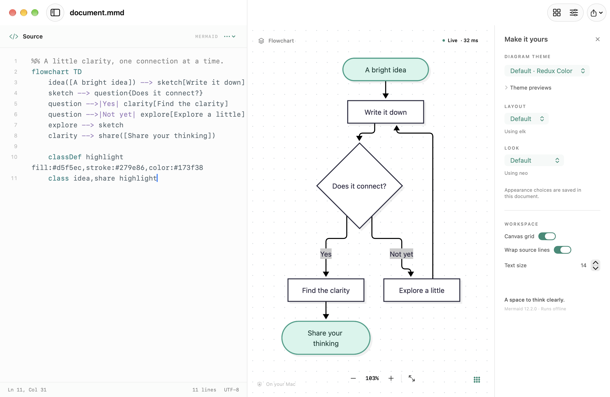

# MacMermaid

A native macOS editor for [Mermaid](https://mermaid.js.org/) diagrams, with live previews and offline rendering.

Write diagram source, see the result as you type, and export it as SVG, PNG, or PDF. MacMermaid combines a native text editor and document workflow with Liquid Glass controls.



*Light app appearance with the Mermaid 12 defaults.*

**Status:** v0.2.0-alpha is held in draft until every milestone issue and required validation check is complete. The premature download was withdrawn. Build from source while the [remaining milestone work](https://github.com/opendream/macmermaid/milestone/1) is completed; see the [validation record](docs/VALIDATION-v0.2.0-alpha.md).

## Features

- **Live preview** with syntax-error feedback and the last valid diagram kept visible while you edit.
- **Native editing** with syntax highlighting, line numbers, find and replace, undo and redo, and line wrapping.
- **Local documents** in `.mmd` and `.mermaid` formats, with autosave, recent files, multiple windows, and native window tabs.
- **Templates and themes:** 15 starting templates and 11 diagram themes, including Redux Color, Catppuccin Latte/Mocha, and Tokyo Day/Night. Horizontal/vertical swimlanes and UML use cases are included.
- **Document appearance:** portable theme, layout, look, and supported connection settings saved in Mermaid frontmatter.
- **Visual selectors:** collapsible theme palettes and look samples, with controls and selections following your macOS accent color.
- **Flexible exports:** SVG, PNG, and vector PDF, plus SVG copying to the clipboard.
- **Offline rendering:** Mermaid is bundled with the app. Rendering needs no account, server, or CDN.

## Get started

### Download

There is currently no approved binary download. The v0.2.0-alpha release is a draft while validation and fixes are completed. The intended package is `MacMermaid-v0.2.0-alpha-macos-arm64.zip` for **Apple Silicon Macs running macOS 26 or later**, with checksums and validation evidence.

This build is ad hoc signed, **not Developer ID signed or notarized**. macOS may block its first launch. Build from source if you prefer a local build; no Intel binary is provided in this alpha. Runtime validation was performed on macOS 27.0.1, not macOS 26.

### Build requirements

- macOS 26 or later.
- Xcode 26 or later, with Swift 6.2 or later available to command-line builds.
- Git and Python 3 (`python3` on your `PATH`).

### Build and run

```sh
git clone https://github.com/opendream/macmermaid.git
cd macmermaid
./scripts/build.sh
open build/MacMermaid.app
```

The script builds and locally signs an app for your Mac's architecture. Once the source and development tools are installed, building and running do not require npm or a network connection.

For an optimized build, use `./scripts/build.sh release`. See the [development guide](docs/DEVELOPMENT.md) for toolchain checks, tests, and packaging details.

## Your first diagram

1. Open a `.mmd` or `.mermaid` file, or press **⌘N** for a new document.
2. Edit the source on the left. The preview updates automatically. Use **⇧⌘N** to start from a template.
3. Press **⌘S** to choose where to save. macOS handles subsequent autosaves.
4. Choose **File → Export Diagram** to export an image, or press **⇧⌘C** to copy SVG.

**MacMermaid → Settings → Appearance** controls the app and editor's light or dark appearance. The toolbar's appearance inspector saves diagram choices in the current document. New documents use Redux Color and Mermaid 12's native layout/look defaults; the app's light/dark appearance remains independent.

See the [user guide](docs/USAGE.md) for shortcuts, canvas controls, themes, and export behavior. New to the syntax? Start with the [Mermaid documentation](https://mermaid.js.org/intro/).

## Current limitations

- Rendering uses the bundled **Mermaid 12.2.0** engine; syntax support follows that version.
- Remote images, clickable diagram links, and remotely loaded icon packs are disabled.
- Exports are available only when the current source renders successfully.
- Large swimlanes can be slow, produce malformed empty lanes, or overlap long lane headings. Return arrows directly into swimlane decision diamonds can detach; the supplied templates avoid that pattern.
- Fit currently has a 5% minimum zoom, which can clip very wide diagrams in a narrow preview. SVG export retains the full diagram.
- Look cards use fixed sample illustrations, not miniature renders of the current document.

## Help and contributions

[Open an issue](https://github.com/opendream/macmermaid/issues) to report a bug or suggest a feature. For rendering problems, include a small Mermaid example and your macOS version.

Bug fixes, documentation, design feedback, and pull requests are welcome. Read [CONTRIBUTING.md](CONTRIBUTING.md) for setup, reporting guidelines, and checks to run before submitting a change.

MacMermaid is maintained by [Opendream](https://github.com/opendream) and its contributors.

## License and acknowledgments

MacMermaid's original code is licensed under the [MIT License](LICENSE), copyright © 2026 Opendream and MacMermaid contributors.

Thanks to [Mermaid](https://github.com/mermaid-js/mermaid), [Catppuccin](https://github.com/catppuccin/palette), [Tokyo Night](https://github.com/folke/tokyonight.nvim), and their contributors. Bundled third-party components retain their respective licenses; full attributions and license texts are in [THIRD_PARTY_NOTICES.md](THIRD_PARTY_NOTICES.md) and included in the app.
