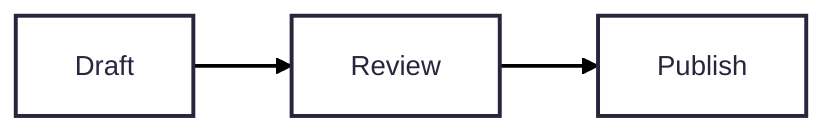

# Using MacMermaid

[Back to the README](../README.md)

## Documents and editing

Open a `.mmd` or `.mermaid` file, or create a new document with **⌘N**. Files are portable UTF-8 Mermaid source. **⇧⌘N** opens the template picker; selecting a template creates a new document without replacing your current work.

Save a new document once with **⌘S** to choose its location. macOS then manages autosave and document version history. You can open several windows and use **Window → Merge All Windows** to collect them into native tabs.

The editor supports syntax highlighting, line numbers, indentation, undo/redo, find and replace, and line wrapping. Adjust text size and wrapping in **MacMermaid → Settings** or the appearance inspector.

When the source has a syntax error, the last valid preview stays visible. Export and SVG copying become available again after the current source renders successfully.

## Canvas controls

- Drag or scroll to pan.
- Pinch or use **⌘-scroll** to zoom.
- Double-click the canvas or press **⌘0** to fit the diagram.
- Use the floating controls to zoom and fit; the dotted grid can be toggled in the inspector.

## Appearance and themes

**MacMermaid → Settings → Appearance** controls the app and source editor. **System** follows macOS; **Light** and **Dark** override it. The editor keeps its standard syntax colors in each appearance.

The toolbar's appearance inspector edits the current document. New documents use **Redux Color**, with **Neo** and **ELK** where the diagram type supports them. Swimlanes keep their dedicated layout, and mind maps retain their native layout. Mermaid 12's layout and appearance changes are intentional.

| Theme | Palette |
| --- | --- |
| Redux Color | Mermaid 12's colorful default |
| Studio | Soft green |
| Ocean | Blue |
| Mermaid | Mermaid's original standard theme |
| Forest | Green |
| Mono | Neutral |
| Midnight | Dark |
| Latte | Catppuccin Latte |
| Mocha | Catppuccin Mocha |
| Tokyo Day | Tokyo Night's Day palette |
| Tokyo Night | Tokyo Night's Night palette |

Choose a theme from the menu, or expand **Theme previews** to see the color cards. Explicit theme choices are fixed independently of the app's light/dark appearance. They do not recolor the editor, toolbar, or inspector.

**Layout** offers ELK and Dagre for supported graph diagrams. **Look** offers the styles the diagram supports: Neo, Classic, and Hand-drawn. **Connections** appears for flowcharts using Dagre, where Smooth, Straight, and Stepped change the actual paths. It is hidden for ELK and swimlanes.

Mind maps keep their native layout because an explicit ELK override fails in the bundled 12.2.0 engine. Swimlanes also keep their dedicated layout. Their supported look choices remain available.

**Default** removes the applicable explicit override and lets Mermaid choose. **Custom** means the source configuration does not match one of the presets. Manual frontmatter edits update the inspector. Node-level styles in your diagram can still override theme colors.

### Portable appearance

Inspector changes edit standard Mermaid YAML frontmatter in the `.mmd` file:

Custom palettes use `theme: base` and explicit `themeVariables`, so a Mermaid 12.2.0 renderer outside MacMermaid can interpret the same file. Each open document keeps its own choices. Save, close, and reopen preserves them; **⌘Z** and **⇧⌘Z** undo and redo inspector changes together with source edits.

Comments, unrelated configuration, and the diagram body are retained. Malformed YAML is shown as an error without being replaced. Configuration containing aliases, anchors, merge keys, or legacy init directives must be edited in the source before the inspector can safely change it. The inspector explains these cases.

Default removes the controlled theme colors but preserves unrelated variables such as typography. If these still customize the theme, the menu continues to show Custom.

Grid visibility, editor text size, wrapping, and app appearance remain local preferences. They do not add diagram configuration. Old global theme/connection preferences do not control v0.2 documents; appearance is now owned by the source.

## Swimlanes and UML use cases

**⇧⌘N** opens 15 starting templates. **Horizontal swimlanes** follows a customer request across teams from left to right. **Vertical swimlanes** follows a proposal through review and approval. Both use native `swimlane-beta` syntax and include a decision, a revision path, and handoffs between lanes.

**UML use cases** uses `usecase-beta`, with actors, a library system boundary, and an include relationship. Selecting any template opens a new document and keeps your existing work.

The swimlane templates return revisions to a review step before the decision. In this engine version, a return arrow directly into a decision diamond can detach from its target; inspect routing when adapting the examples.

## Export

Choose **File → Export Diagram** for SVG, PNG, or vector PDF. Use **⇧⌘C** to copy SVG to the clipboard.

Exports include the full diagram regardless of the current zoom or pan, with an explicit background and without canvas dots. PNG exports use 2× resolution where possible, capped at 8192 pixels per side and 24 million pixels.

Rendering is local and uses Mermaid 12.2.0. Remote images, clickable diagram links, and remotely loaded icon packs are disabled. The included templates are starting points; the engine supports additional Mermaid diagram types.

## Keyboard shortcuts

| Action | Shortcut |
| --- | --- |
| New document | ⌘N |
| New from template | ⇧⌘N |
| Open / Save | ⌘O / ⌘S |
| Find / Replace | ⌘F / ⌥⌘F |
| Toggle source editor | ⌥⌘E |
| Toggle appearance inspector | ⌥⌘I |
| Fit diagram | ⌘0 |
| Zoom in / out | ⌘+ / ⌘− |
| Copy SVG | ⇧⌘C |

## Help

Use **Help → Mermaid Syntax Reference** for the [Mermaid documentation](https://mermaid.js.org/intro/). Syntax must be supported by the bundled engine version.

For bugs or feature requests, see the [issue tracker](https://github.com/opendream/macmermaid/issues) and [reporting guidelines](../CONTRIBUTING.md#report-a-bug).
